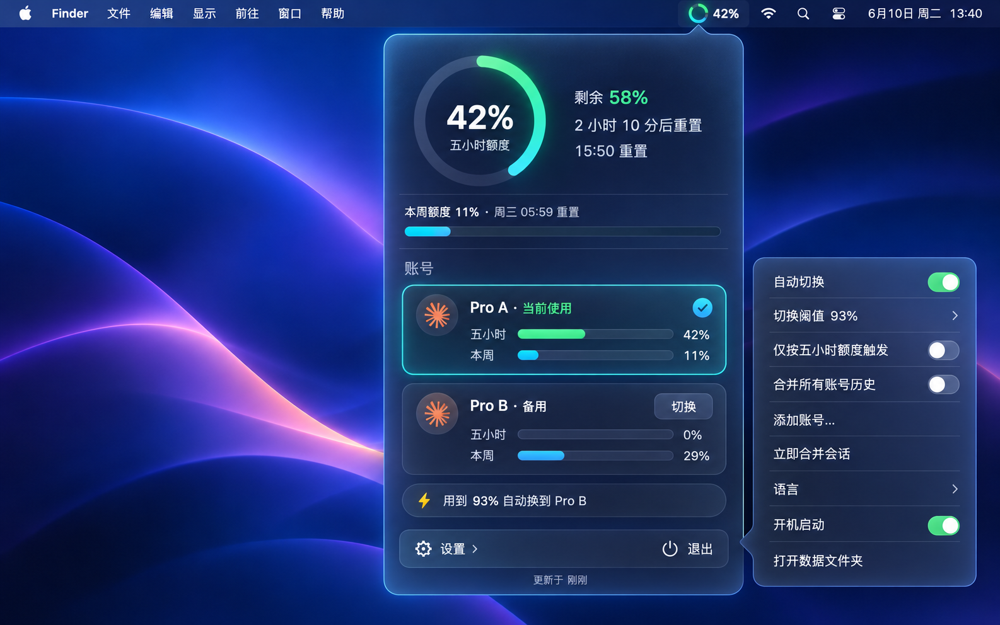

# Relay for Claude · 额度接力

一个 macOS 菜单栏小工具：给 Claude 桌面 App 登记多个订阅账号，当前账号的五小时额度快用完时，自动换到还有余量的账号，让工作接着跑下去。

A macOS menu bar tool for the Claude desktop app. Sign in with several subscription accounts once; when the active account's five-hour limit is nearly used up, Relay switches the app to an account that still has room.

作者 / Author：酷恩



> 上图是界面设计稿，实际界面以运行效果为准。 The image is the design mockup; the real panel follows it closely.

## 功能

- **菜单栏额度圆环**：大号圆环加粗体百分比，一眼看到当前账号五小时额度用了多少。绿色正常，橙色接近上限，红色到达切换阈值。
- **磨砂玻璃面板**：左键点图标弹出。顶部是五小时额度大圆环（剩余多少、多久后重置），下面是本周额度、所有账号卡片（点一下即可切换）和下一次自动切换的目标。右键仍是系统菜单。
- **自动接力**：五小时额度达到阈值（默认 96%，可选 90/93/94/96/98%）时，自动换到额度最充足的账号。可设为只看五小时额度；即使只看五小时，周额度达到 98% 也会强制换号，不会卡住。
- **会话与项目合并**：换号后，其他账号的聊天记录和项目分组会出现在当前账号里。只补齐，从不删除。
- **外观可调**：六种淡色玻璃（灰、蓝、橘黄、薄荷绿、紫、粉），磨砂程度和不透明度两个滑块。
- **运行中保护**：添加账号或合并会话需要重启 Claude。如果 Claude 最近 15 分钟还在写会话（可能有任务在跑），会先弹窗确认，默认是取消。
- 简体中文 / English 界面。

## 安装（从源码构建）

需要 macOS、[Go](https://go.dev/dl/) 1.26 或更新版本，以及 Xcode 命令行工具（`xcode-select --install`）。

```bash
git clone https://github.com/kuen133/relay-for-claude.git
cd relay-for-claude
go test ./...
go build -o relay-for-claude .
./relay-for-claude
```

菜单栏会出现圆环图标。第一次读取额度时，macOS 会询问能否读取钥匙串里的 "Claude Safe Storage"，选择允许即可（原因见下方"安全"）。在设置里打开"开机启动"，以后登录时会自动运行。

## 第一次使用

1. 打开 Claude 桌面 App，登录第一个账号。Relay 会自动记下它。
2. 在面板里点「设置 › 添加账号…」。Claude 会重启到登录页，当前账号的登录状态会先保存好。
3. 用另一个账号登录。重复这一步可以添加更多账号（最多 8 个）。
4. 在设置里打开「自动切换」，选好阈值。

切换账号会重启 Claude 桌面 App，正在运行的任务会被中断；自动切换只在额度确实快满时发生，两次之间至少间隔 10 分钟。

## 安全与隐私

- **只在本机工作。** 登录信息保存在 `~/.relay-for-claude/` 里，文件权限仅本人可读。Claude 的登录令牌始终保持 Claude 自己的加密，Relay 不会以明文写出它们。
- **钥匙串提示**：读取额度需要用 Claude 自己的加密钥匙解开令牌，所以 macOS 会询问一次。
- **网络访问只有两处**：向 `api.anthropic.com` 查询每个账号的用量（和 Claude App 自己用的是同一个接口），以及每天向 GitHub 查询一次是否有新版本（不发送任何个人信息）。
- **改动前先备份**：每次切换前会备份 Claude 的登录配置，失败时自动还原，最多保留 10 份。
- 不登出、不吊销任何账号的令牌。

## 平台说明

- **macOS**：全部功能已在真机上使用验证。
- **Windows**：代码可以编译，保留系统托盘菜单，但没有磨砂玻璃面板和运行中确认弹窗，作者也未在 Windows 上实测。

## 免责声明

这是独立的个人项目，与 Anthropic 无关，未获其认可或支持。"Claude" 是 Anthropic 的商标。使用多个账号请遵守 Anthropic 的服务条款。本软件按"现状"提供，不附带任何担保。

## 许可证

[Apache License 2.0](LICENSE)。部分代码基于其他开源项目，署名见 [NOTICE](NOTICE)。
